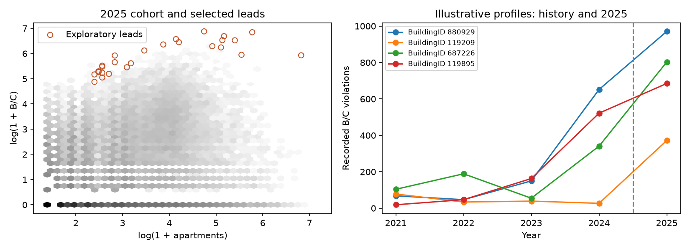

# NYC Housing Anomaly Analysis

**Which buildings warrant closer review because of unusually high or persistent recorded
housing complaints and violations relative to comparable properties?**

This investigative data science project turns public administrative records into auditable
building-level review leads. It demonstrates Python data acquisition, substantive DuckDB/SQL,
interpretable count models, and the judgment needed to separate a useful investigative signal
from a defensible statistical conclusion. It is an independent portfolio project, not an
agency investigation or a finding about any owner.

**Result: 27 exploratory leads, not 27 statistically validated anomalies.** Model calibration
is imperfect, and the review rules control workload rather than false-positive rates.
The analysis covers **2021–2025** activity in a fixed cohort of **145,832 current buildings**.
B/C combines Class B (hazardous) and Class C (immediately hazardous) violations.
Documentation and verification are complete through Phase 7.

## Findings at a glance

| Verified result | What it means |
| --- | --- |
| 27 selected BuildingIDs account for **11,328 B/C violations** in 2025 | 1.98% of the cohort's 571,613 recorded B/C violations; not independent defects or affected households |
| **23 of 27** had B/C activity in every year from 2021 through 2024 | Recurrence of recorded activity, not proof that the same conditions remained unrepaired |
| Excluding shared-lot or geographic ambiguities retained **23 of 27** | Four primary leads were removed and four replacement leads entered |
| Switching HPD to PLUTO units retained **25 of 26** comparable selections | Rate-denominator sensitivity on an identical, restricted population; model expectations stayed frozen |
| Requiring agreeing unit counts retained **16 of 27** primary leads | Population restriction matters more than the denominator switch alone; the restricted queues contain 23 leads |

The comparable HPD population itself retains **21 of the 27** primary leads. That restriction
must be distinguished from the subsequent 25-of-26 denominator comparison. No primary lead
has a recorded event-geography conflict, but missing flags do not prove correct linkage.
Counts and membership are available in the [investigative report](reports/phase6/README.md),
[sensitivity table](reports/phase6/sensitivity.csv), and [verification record](reports/phase6/VERIFICATION.md).



Left: building capacity and B/C burden on log(1+x) axes, retaining zeros. Right: four
illustrative profiles chosen by explicit rules, with 2025 separated from prior years.
Profiles illustrate raw-count, rate, residual and denominator-review cases; they are not a
representative sample or a ranking of the worst properties.

## How leads were selected

Common gates require at least 10 HPD apartments, 20 recorded B/C violations in 2025,
2 expected violations, 10 observed-minus-expected violations, and an observed/expected
ratio of at least 2, within the cohort's full-year source coverage. From this screen,
take the top ten buildings separately by raw B/C count, B/C per 100 apartments, and
NB2 Pearson residual. Break ties by numeric BuildingID and deduplicate the union.
There is no composite score. The [selection plan](reports/phase6/selection_plan.json) and
[indicator queues](reports/phase6/indicator_queues.csv) expose the rules and every selection reason.

These are **operational review rules documented after the 2025 model evaluation**, not
preregistered holdout thresholds, calibrated tail probabilities, or error-rate controls.
Agreement among related indicators does not provide independent statistical confirmation.
Persistence was not a selection gate or ranking variable, but historical records were model
training outcomes; it is descriptive context, not independent corroboration. Complaints can
prompt inspections, so complaint/violation agreement is also not independent evidence.

## Data and population

| Public NYC Open Data source | Grain and use |
| --- | --- |
| [HPD complaints and problems — ygpa-z7cr](https://data.cityofnewyork.us/d/ygpa-z7cr) | Distinct complaints and their problem rows, dated by receipt |
| [Housing Maintenance Code violations — wvxf-dwi5](https://data.cityofnewyork.us/d/wvxf-dwi5) | Distinct violations, dated by inspection; Class B and C kept separate and combined |
| [HPD buildings — kj4p-ruqc](https://data.cityofnewyork.us/d/kj4p-ruqc) | BuildingID, current apartment capacity, inventory and management attributes |
| [PLUTO — 64uk-42ks](https://data.cityofnewyork.us/d/64uk-42ks) | Tax-lot characteristics, construction/alteration years and residential-unit comparison |

The retained snapshot contains **9,439,989 source rows**, extracted November 2 and 5, 2026.
Two corrupted partitions were replaced and audited; all 17 blocking Phase 2 integrity checks
passed. The [quality review](reports/phase2/QUALITY_REVIEW.md) documents repairs and exclusions.
Source selection is explicit in [housing/sources.py](housing/sources.py).

The final cohort requires valid identifiers, current active status, at least three HPD
apartments, zero reported Class B rooms, known non-NYCHA management, and PLUTO residential
use. It excludes shared active BINs, missing or post-start construction years, and recorded
alterations at or after 2021. Both sources must cover all study months. This is current stock
with conservative history screens, not a reconstruction of all historical rental housing.
Class B rooms are an inventory field, distinct from Class B violations.

HPD apartments supply building capacity; PLUTO lot totals are never assigned wholesale to
multiple buildings. Agreement is a sensitivity subset, not the final primary denominator
rule. Zero-event buildings remain in the cohort. See the [cohort contract](reports/phase3/README.md).

## Analytical workflow and technical implementation

| Stage | Implementation and evidence |
| --- | --- |
| Acquire and validate | [Python downloader](housing/download.py): schema checks, keyset pagination, retries, resumable partitions, source-count reconciliation and SHA-256 manifests |
| Normalize and link | [DuckDB orchestration](housing/database.py) and [SQL](sql/): typed identifiers/dates, BuildingID joins, BBL/BIN conflict flags, cardinality checks and event conservation |
| Engineer features | [Cohort SQL](sql/phase3/features.sql): building/year rows, distinct complaints/problems, separate B/C, zero activity, persistence and capacity-based exposure; earlier SQL also supplies monthly/rolling metrics |
| Fit count baselines | [Phase 4](housing/phase4.py): Poisson log-link baseline, then NB2 after training Pearson dispersion of 33.37; size, age, borough and calendar controls with apartment exposure |
| Diagnose and validate | [Phase 5](housing/phase5.py): 2023/2024 rolling validation, piecewise-size NB2 selection, refit through 2024, frozen 2025 evaluation, subgroup calibration and paired BBL bootstrap diagnostics |
| Review leads | [Phase 6](housing/phase6.py): saved predictions, separate indicator queues, illustrative histories, descriptive peers and denominator/linkage sensitivity; no model refit |

Python uses requests, pandas, NumPy, SciPy, statsmodels and Matplotlib; DuckDB performs the
core relational transformations. There is no required cloud account or notebook runtime.
No owner attribution, Isolation Forest, dashboard or agent workflow was implemented.
The [original design and final scope note](docs/analytical_design.md) preserve that distinction.


Recorded B/C rises through 2024 and falls in 2025, while complaints follow a different path.
Roughly 80% of building-years have zero recorded B/C. Neither pattern identifies underlying
housing conditions independently of reporting and inspection activity.


The size-adjusted NB2 model improves broad mean calibration, but does not validate anomaly
tails. Its 2025 aggregate observed/expected ratio is **0.932**, and conditional 95% count
intervals cover **98.37%** of observations. Historical-activity groups remain poorly
calibrated: O/E is **2.60** for the 20+ prior-mean-annual-B/C group and **0.15** for zero
history. The middle plot uses log axes and omits zero-rate dots; its underlying CSV retains
them. See [calibration evidence and uncertainty qualifications](reports/phase5/README.md).

## Limitations and responsible interpretation

- **Historical exposure:** Current units, eligibility and property attributes do not establish
  historical occupancy, rental tenure or stable physical capacity. Survivor selection remains.
- **Linkage:** BuildingID, BIN and tax lot are different entities. Shared lots, conflicting
  keys and absent values limit physical-property attribution; a zero conflict count is not verification.
- **Reporting and inspection:** No complete inspection denominator is available. Recorded
  counts reflect access to reporting and enforcement opportunity as well as conditions.
  Multiple violations may arise from one inspection; duplicate-flagged problems remain visible.
- **Calibration and evaluation:** Size adjustment does not resolve historical heterogeneity,
  serial/spatial dependence or the 2025 trend reversal. The model choice used pre-2025 folds,
  but specification work followed Phase 4's examination of 2025; this is retrospective
  evaluation, not an untouched test or demonstrated deployment performance.
- **Uncertainty and source revisions:** Count intervals condition on fitted parameters.
  The lot bootstrap measures conditional empirical stability, not all uncertainty. Live
  records and statuses change; mixed extraction dates cannot reconstruct repair histories.
  Full source-month coverage does not establish complete reporting. Alternative violation-date
  sensitivity remains unresolved.

Consequential use requires verification of source records, property identity and exposure.
These findings do not establish wrongdoing, continued defects, causal effects, or investigative accuracy.

## Setup and review without downloading data

Use Python **3.11+** and `uv`, from the repository root. The retained run used Python 3.14;
[pyproject.toml](pyproject.toml) declares dependencies and [uv.lock](uv.lock) pins resolution.

```sh
uv sync --locked
uv run python -m housing --help
uv run python -m pytest -q
uv run python -m ruff check .
uv run python -m ruff format --check .
uv run python scripts/check_docs.py
```

Dependency installation needs network access unless cached. A public clone can run synthetic
ETL/model tests and report/provenance checks without NYC data. Four local-data reconciliation
tests skip when the ignored database/snapshot is absent. With the retained local inputs,
**44 tests pass with no skips**. This does not mean a fresh live-source rebuild was rerun
for the documentation review.

For a full rebuild, cached-data review, exact prerequisites, overwrite behavior and resource
requirements, follow [reproduction instructions](docs/reproduction.md). The pipeline processes
millions of rows: the retained compressed source files occupy about 187 MiB and the database
about 921 MiB, before temporary build files and Python/model memory. Allow several GB of free
disk; the configured DuckDB memory limit is 4 GB. End-to-end runtime was not benchmarked.

## Repository guide

- [housing/](housing/) — acquisition, database orchestration, models and report renderers.
- [sql/](sql/) — staging, linkage, metrics, audits and cohort features.
- [tests/](tests/) — synthetic edge cases and saved-output reconciliation.
- [reports/phase2/](reports/phase2/) and [phase3/](reports/phase3/) — source audit and cohort decisions.
- [reports/phase4/](reports/phase4/) and [phase5/](reports/phase5/) — baseline and calibration evidence.
- [reports/phase6/](reports/phase6/) — final investigative report, lead tables and verification.
- [Phase 7 publication review](reports/phase7/VERIFICATION.md) — setup, artifact and link checks.

Earlier reports record what was known at each phase; their provisional decisions and test
counts are historical. The root README describes the completed scope. Raw extracts, full
prediction files, DuckDB, environments and caches are ignored; lightweight reports and frozen
coefficients are retained. Published BuildingIDs are public administrative identifiers, not
anonymized properties. Lead exports omit addresses, apartment identifiers and owner/resident
contact information. No code license has been selected; source-data access is governed by
NYC's terms, separately from any future code license.
