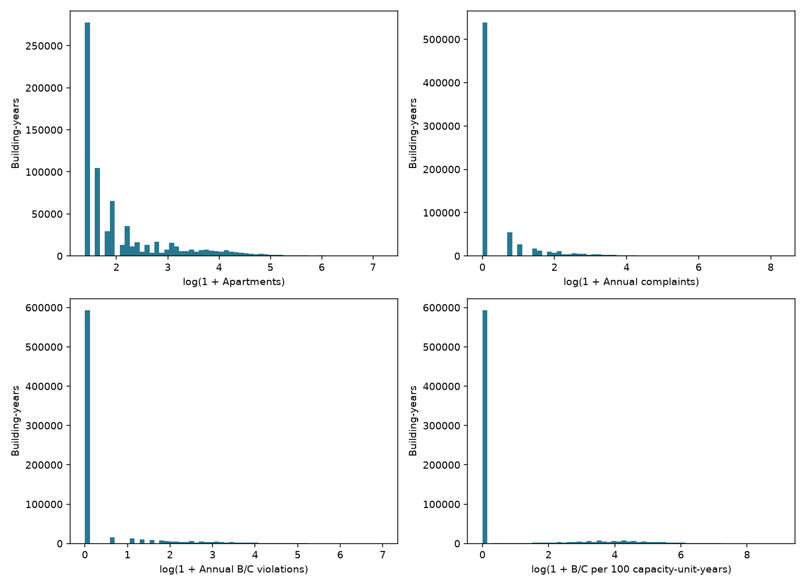
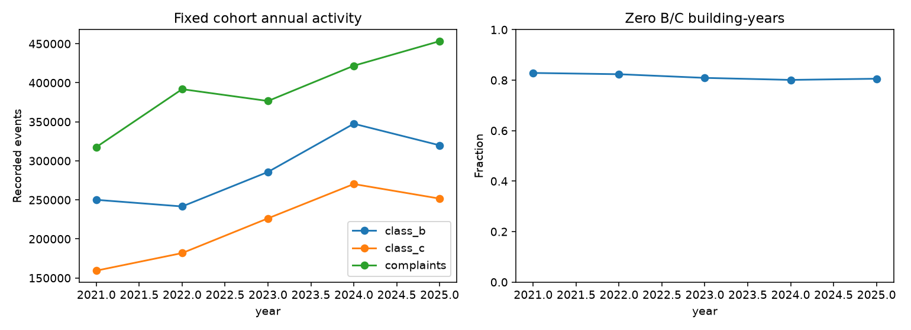
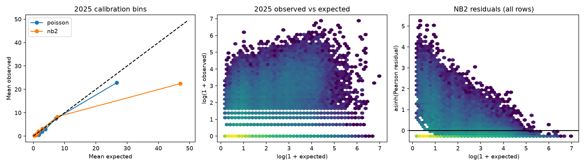

# Exploratory analysis and count baselines (Phase 4)

## In short

- Fit first-pass models on 2021–2024 to predict each building's 2025 serious violations
  from its size, age, borough and year.
- A Poisson model couldn't handle how uneven the counts are (training dispersion
  33.37, where about 1 is expected), so a negative binomial model was added.
- The negative binomial model got the share of zero-violation buildings about
  right, but predicted far too many violations overall: actual 2025 violations were
  62% of predicted.
- Neither model was good enough to flag outliers. Fixing the size problem is the job of the
  next stage, [model validation](../model_validation/README.md).

Reproduce from the repository root with `uv sync --locked` and
`OPENBLAS_NUM_THREADS=1 VECLIB_MAXIMUM_THREADS=1 uv run python -m housing.baseline_models`.
The runner reads existing DuckDB tables without changing them. No source downloads,
Isolation Forest, owner analysis, dashboards, or investigative rankings were added.

## Population, distributions and observation window

The fixed Phase 3 cohort has **145,832 buildings** and **729,160 building-years**.
Median apartment capacity is 4; the 99th percentile is 173 and the maximum is 1,320.
Annual B/C counts have median zero, pooled 99th percentile 69, and maximum 1,092.
The pooled annual rate has 99th percentile 433.33 B/C per 100 capacity-unit-years.
Counts are highly concentrated: annual zero-B/C fractions range from
80.1% to 82.9%, while annual
variance/mean ratios range from 60.8 to
93.0. These marginal ratios are descriptive; conditional
Poisson dispersion, below, determines the NB comparison.

Histogram axes use log(1+x), retain zeros and show the entire range; distributions.csv
provides untransformed quantiles. Apartment observations repeat once per year in that file,
so their distribution is also the fixed building distribution. eda_borough_id.csv and
eda_building_class.csv describe outcome differences and capacity-normalized rates;
these are associations, not effects of geography or property type.

Train on **2021–2024**, evaluate **2025** once under a prespecified set of comparisons.
B/C totals rise from 409,527 in 2021 to 617,873 in 2024, then fall to 571,613 in 2025.
No 2025 outcomes, complaints, statuses, five-year totals or persistence measures enter
predictors. Year is a known calendar variable. The primary calendar effect is a linear
log-rate trend learned through 2024 and extrapolated to 2025; the reversal is an explicit
stress test, not corrected using the evaluation total. The window sensitivity drops 2021.
No model is selected or recalibrated on 2025 and then called an untouched holdout.

**This remains retrospective evaluation.** Phase 3 eligibility, current unit counts and
property attributes were obtained in 2026, not reconstructed as known at the end of 2024.
Excluding outcome-derived predictors prevents direct target leakage but cannot remove
survivorship, retrospective revisions or post-period attribute selection. Results do not
measure genuine deployment forecasting or generalization to new buildings.

## Specification and estimation

For building i and year t, log(mu_it) = log(apartments_i) + intercept + beta_size *
log(HPD apartments_i) + beta_age * (2021 - construction year)/100 + beta_time *
(t - 2021) + four borough indicators (Manhattan reference).
Every row has 12 observed months, so the offset is one capacity-unit-year per apartment.
The size term permits departures from proportional scaling; it does not replace the offset.
Only size, age, borough and time are modeled. Fine property classes/stories are deliberately
left for later specification review rather than introducing many sparse parameters.
No building IDs or contemporaneous complaints are controls.

Poisson uses a log-link GLM. Training Pearson dispersion is **33.37**,
well above the declared 1.5 diagnostic trigger. Accordingly, fit NB2 by maximum likelihood,
with variance mu + alpha*mu² and jointly estimated **alpha = 13.459**. Every fit must
converge and all predictions must be finite and positive. Coefficients and alpha are saved
in coefficients.csv. Implementation follows the official
[Statsmodels GLM documentation](https://www.statsmodels.org/stable/glm.html) and
[Negative Binomial API](https://www.statsmodels.org/stable/generated/statsmodels.discrete.discrete_model.NegativeBinomial.html).

No coefficient significance claims are made. Repeated building observations and shared lots
violate independence assumptions; alpha is an overdispersion approximation, not a complete
model of serial or spatial dependence. Predictive intervals below condition on fitted
parameters, ignoring estimation uncertainty and persistent latent building effects.

## Evaluation and calibration

**Neither baseline is adequately calibrated for formal anomaly thresholds.** Poisson's
2025 mean negative log likelihood is 6.468, compared with 1.173 for NB2. NB2 predicts
79.56% zeros versus 80.58% observed; Poisson predicts only 21.65%. But NB2 predicts
928,303 total violations against 571,613 observed (O/E 0.616), versus Poisson's
698,127 (O/E 0.819). NB2 also overpredicts in training (O/E 0.664), so the problem
is not solely the 2025 trend reversal. NB2's 98.28% interval coverage is conservative,
while Poisson covers only 75.66%. NB2 MAE worsens from 5.69 to 6.90. Improvements
in distributional likelihood therefore do not establish superior mean prediction.

| model | n | aggregate_oe | mean_negative_log_likelihood | mae | interval95_coverage | predicted_zero_fraction |
| --- | --- | --- | --- | --- | --- | --- |
| poisson | 145,832 | 0.82 | 6.47 | 5.69 | 0.76 | 0.22 |
| nb2 | 145,832 | 0.62 | 1.17 | 6.90 | 0.98 | 0.80 |
| comparable_hpd | 120,570 | 0.64 | 1.22 | 7.04 | 0.98 | 0.79 |
| comparable_pluto | 120,570 | 0.64 | 1.22 | 7.03 | 0.98 | 0.79 |
| agreement | 94,728 | 0.62 | 1.10 | 6.06 | 0.98 | 0.81 |
| training_linkage_clean | 144,686 | 0.61 | 1.17 | 6.97 | 0.98 | 0.80 |
| exclude_2021 | 145,832 | 0.60 | 1.17 | 7.05 | 0.98 | 0.79 |

Negative log likelihood and MAE are lower-is-better. Aggregate O/E should be near one.
The 95% intervals are discrete equal-tail count intervals; nominal coverage need not be
exactly 95%. Observed zero prevalence is in model_metrics.csv alongside predicted prevalence,
training/evaluation dispersion, residual 99th percentiles, and Poisson deviance.
Do not compare likelihoods between differently selected populations as if they were the
same test set; the comparable HPD/PLUTO pair uses exactly the same buildings.

Calibration curves use expected-count bins and a 45-degree reference. Bins are descriptive
and not used to refit. Hexbin colors encode log observation density; residuals use asinh
scaling to show both tails without deleting extreme rows. calibration.csv gives borough,
size-band and expected-decile observed/expected means and residual means. Broad population
calibration can conceal poor calibration in particular groups or the upper tail.

Building-level evaluation files are stored locally under `data/baseline_models/*_2025.csv.gz`, ordered
by BuildingID rather than a priority score. They contain observed and expected counts,
O/E, observed-minus-expected, Pearson residuals, conditional intervals and an expected<1
flag. O/E is not a ranking or significance statistic. Large ratios at tiny expectations
need absolute excess, uncertainty, linkage review and substantive evidence.

## Focused sensitivities

All variants are refitted only on their designated training rows:

- Comparable one-building lots: paired HPD and PLUTO offsets on identical rows. The size
  predictor remains HPD size in both, isolating the exposure-source change. No whole-lot
  units are assigned to a building on a multi-building lot.
- Agreement subset: corroborated unit counts; distinguish sample-selection effects from
  denominator changes using the comparable pair and sensitivity.csv.
- Linkage: exclude buildings with BBL/BIN/component conflicts in **training events only**.
  Do not use the Phase 3 all-period clean-linkage flag, which includes evaluation events.
  Shared active BINs were already excluded by Phase 3. No rematching is attempted.
- Window: train on 2022–2024 instead of 2021–2024; retain the same 2025 target.

| model | common_buildings | expected_spearman | median_expected_ratio | residual_spearman |
| --- | --- | --- | --- | --- |
| poisson | 145,832 | 0.94 | 1.53 | 0.81 |
| nb2 | 145,832 | 1.00 | 1.00 | 1.00 |
| comparable_hpd | 120,570 | 1.00 | 1.02 | 1.00 |
| comparable_pluto | 120,570 | 0.98 | 1.04 | 0.98 |
| agreement | 94,728 | 1.00 | 1.00 | 1.00 |
| training_linkage_clean | 144,686 | 1.00 | 1.00 | 1.00 |
| exclude_2021 | 145,832 | 1.00 | 1.00 | 1.00 |

The CSV above summarizes common-building expected-count and residual Spearman correlations
and median expected ratios; it is not a final ranking. sensitivity.csv contains the full
precision values. Shared input populations matter when interpreting stability.

## Limits and readiness for subsequent anomaly identification

NB2 can improve count likelihood and zero/interval calibration without resolving systematic
mean errors, tail misfit or temporal drift. For 50+ apartment buildings, NB2 predicts
55.97 violations per building in 2025 versus 20.56 observed; the 3–9 apartment group
is much closer (0.98 expected versus 0.94 observed). The large-building mean specification
is therefore a priority for training-only revision, not a reason to recalibrate on 2025.
Inspect the computed subgroup tables before
using residuals as an investigative screen. Poor calibration precludes formal significant
outlier claims. The high zero fraction is not by itself evidence for a zero-inflated model;
recording and inspection opportunities remain unobserved.

Historical capacity, occupancy, rental tenure and inspection exposure are not established.
HPD/PLUTO discrepancies and the mixed November 2/5 snapshot persist. Administrative A/I
volume shifts should not be conflated with B/C activity. Geographic controls can normalize
widespread adverse conditions; retain broad as well as local comparisons in future work.

Next: review temporal and subgroup calibration, consider a training-only temporal backtest,
check sensitivity of practical excess measures, and validate consequential records before
any anomaly thresholds or multiple-testing procedure. Obtain cluster-aware uncertainty if
inferential claims become necessary. No statistical anomaly establishes wrongdoing.

## Validation and artifacts

Tests cover positive/full exposure, duplicate rows, valid counts, predictor separation from
outcomes, deterministic fitting, output identities and NB dispersion estimation. Run
`python -m pytest -q` and `python -m ruff check housing tests`. provenance.json records the
input query/hash, code and dependency lock hashes, software versions and observation windows.
The database and source files are unchanged. Phase 4 stops at baselines and diagnostics.
