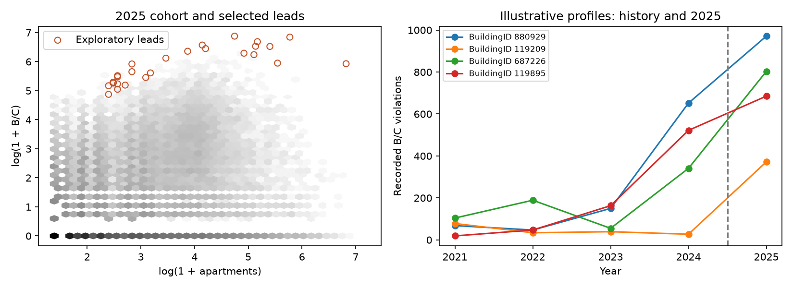

# Exploratory leads for review (Phase 6)

## In short

- Out of 145,832 buildings, 3,934 passed the screening rules
  and **27 were flagged for review**: the top 10 on each of three lists (total serious
  violations, violations per apartment, and how far above the model's prediction).
- The flagged buildings had 11,328 serious violations in 2025,
  1.98% of the total. 23 of them also had serious
  violations in every year from 2021 to 2024.
- Most of the list holds up when the rules change; see the sensitivity table below.
- These are leads for checking records, not findings that anyone broke the law.

**These are leads for record review, not findings of illegal conduct or wrongdoing.**
This is retrospective prioritization of recorded activity, not validated statistical anomaly
detection or evidence of investigative accuracy. No composite score is constructed.

Reproduce with `uv run python -m housing.leads`. The runner reads the existing Phase 3
cohort and saved Phase 5 `nb_size` predictions. It verifies saved expectations against
frozen coefficients, checks cohort/observation/outcome alignment, and never calls a fit
routine. No database or earlier model artifacts are modified. selection_plan.json and
provenance.json document review rules and hashes. BuildingIDs are public administrative
identifiers; outputs deliberately omit addresses, apartment identifiers, resident information,
owner names and contacts. They are not anonymized property identifiers.

## Scope and strongest findings

The 2025 cohort has **145,832 buildings** and **571,613 B/C
violations**. **3,934 buildings** meet the common review gates. The union
of three queues contains **27 leads**, with **11,328 B/C violations**
(1.98% of cohort B/C), **4,371 distinct
complaints** and **8,516 complaint-problem rows**.
**23 leads** had B/C activity in every year 2021–2024.
**0 leads** have geographic-key conflicts somewhere in
2021–2025 and **5** have disagreeing comparable unit counts.
These counts describe selected recorded burden, not verified physical defects or households.

## Transparent selection and exposure safeguards

Common gates: HPD apartments ≥10; 2025 B/C ≥20; frozen expected B/C ≥2;
observed minus expected ≥10; O/E ≥2; and the existing cohort's full 12-month source coverage.
Within that screen, take up to ten buildings separately by raw B/C, B/C per 100 HPD
apartments, and Pearson residual. Break ties by ascending numeric BuildingID. Deduplicate
the union, without adding ranks or weighting indicators. At most 30 leads can result.
indicator_queues.csv retains each selection reason and queue position; leads.csv is sorted
by identifier. These operational thresholds limit review volume and tiny-denominator effects;
they are not estimated error controls, validated cutoffs, or a definition of acceptable housing.
Smaller buildings and below-threshold burdens remain in the cohort, not labeled low risk.
Queues and indicators are mathematically related; agreement across them is not independent
statistical confirmation. Sensitivity below does not tune the primary cutoffs. These
Phase 6 review rules were documented after Phase 5 had evaluated 2025; they are not
preregistered holdout thresholds or a fresh test on unseen outcomes.

Rate = 100 × B/C / current HPD apartments, with a full observed calendar year.
O/E and NB2 Pearson residual use unchanged Phase 5 expectations and dispersion.
The model's 2025 aggregate O/E was 0.932, with 98.37% conditional 95% count-interval coverage and
substantial historical-activity miscalibration (O/E 2.60 in the 20+ historical-activity
stratum versus 0.15 in the zero-history stratum). The intervals condition on fitted
parameters and do not capture parameter, linkage, exposure or reporting uncertainty.
Neither residual cutoffs nor extreme O/E values have validated tail probabilities.
No p-values, significance flags or wrongdoing claims are supplied.

Left: all cohort buildings in log-scaled density bins, with leads outlined. Right: four
deterministically chosen profiles, separating prior years from 2025 with a dashed line.
Zeros are retained. Selection on 2025 necessarily highlights extreme 2025 activity; past
activity is descriptive context, not independent corroboration.

## Illustrative building profiles

Profiles are the highest raw count, then highest rate among remaining leads, then highest
residual among remaining leads, plus the highest raw-count remaining lead with a denominator
or linkage review flag. The same identifier tie-break applies. They illustrate selection and
quality-review routes, not representative samples or the most problematic properties.

| building_id | selected_units | class_b | class_c | rate | expected | oe | pearson_residual |
| --- | --- | --- | --- | --- | --- | --- | --- |
| 119209 | 16 | 202.00 | 170.00 | 2,325.00 | 18.21 | 20.43 | 5.39 |
| 119895 | 169 | 352.00 | 333.00 | 405.33 | 35.22 | 19.45 | 5.12 |
| 687226 | 175 | 562.00 | 241.00 | 458.86 | 11.82 | 67.95 | 18.54 |
| 880929 | 114 | 638.00 | 333.00 | 851.75 | 30.08 | 32.28 | 8.68 |

Context and denominator review:

| building_id | borough_id | pluto_units | buildings_on_lot | complaints | problems | years_with_bc | peer_n | peer_rate_p90 | unit_comparison |
| --- | --- | --- | --- | --- | --- | --- | --- | --- | --- |
| 119209 | 2 | 16 | 1 | 57.00 | 196.00 | 4 | 3,936 | 285.71 | agreement |
| 119895 | 2 | 170 | 2 | 816.00 | 950.00 | 4 | 723 | 100.00 | not_one_building_to_one_lot |
| 687226 | 4 | 175 | 1 | 152.00 | 281.00 | 4 | 819 | 30.63 | agreement |
| 880929 | 2 | 114 | 1 | 175.00 | 347.00 | 4 | 1,782 | 136.83 | agreement |

Borough codes: 1 Manhattan, 2 Bronx, 3 Brooklyn, 4 Queens, 5 Staten Island.
The raw-count illustration is BuildingID 880929 (971 B/C); the rate illustration is
119209 (372 B/C across 16 HPD apartments, or 2,325 per 100 apartments); the residual
illustration is 687226 (803 B/C against 11.82 expected). These measure different aspects
of recorded burden, and a rate above 100 does not mean more than 100% of households
are affected. Each has agreeing HPD/PLUTO counts and no recorded linkage ambiguity.
BuildingID 119895 illustrates denominator review: 685 B/C and 169 HPD apartments,
while PLUTO records 170 units on a lot with two buildings. Those lot units are not a
substitute building denominator, even though the numeric difference is small. All four
profiles have B/C in each prior year; that describes recurrence of records, not proof
that the same defects persisted or independent validation of selection.

Full profiles and all lead attributes are in profiles.csv and leads.csv; annual complaint,
problem, B and C series for every lead are in lead_history.csv.

Peer groups use the same borough and HPD apartment counts from half to twice the target's
count, excluding the target. Peers include zero-event buildings and other selected leads.
Summaries require at least 30 peers; smaller groups are explicitly unavailable rather than
silently widened. leads.csv provides peer sample size, medians, 90th percentiles and the
percentage strictly below the target for counts, rates and complaints. These broad peer
comparisons do not adjust for tenure, condition, inspection opportunity or neighborhood.
A peer percentile is descriptive, not a significance level. Shared lots may also induce
correlation between otherwise distinct BuildingIDs.

## Persistence, complaint context and data quality

History reports total 2021–2024 B/C, years with any B/C, and years with ≥20 B/C.
Persistence is not a selection gate or queue-ranking variable. None of these history summaries
is a predictor in the selected peer model; its predictors are size, age, borough and
calendar time. Historical records did participate as training outcomes, so this evidence is
not statistically independent of model estimation. Persistence can reflect stable conditions,
reporting or inspections; it does not establish continued uncorrected defects.

Complaints count distinct complaint IDs; problems count distinct problem IDs. The pipeline
already checks complaint-to-building/month consistency, so annual complaint aggregation does
not multiply IDs across months. Duplicate-flagged problem counts and distinct reporting days
are included separately. Flags are retained as reporting context, not silently deleted.
Complaints can prompt inspections, so complaint/violation agreement is not independent
confirmation. No direct complaint-to-violation causation is asserted.

Lead-level flags include HPD/PLUTO units and comparison category, geographic conflicts
(reported BBL, component BBL, BIN and internal BBL disagreements), number of active HPD
records sharing the lot/BIN, and approval-before-inspection dates. All-period and 2025
geographic conflict counts are separate and count problem/violation rows, not distinct
complaints. Missing/invalid geographic values cannot always produce a conflict flag;
no flagged-count-zero building is declared error-free. Source coverage is observed
publication, not proof of complete reporting or historical occupancy.

## Selection sensitivity without changing the model

| scenario | base_leads | scenario_leads | retained | removed | added | jaccard |
| --- | --- | --- | --- | --- | --- | --- |
| exclude_ambiguous | 27 | 27 | 23 | 4 | 4 | 0.74 |
| comparable_HPD_vs_full | 27 | 26 | 21 | 6 | 5 | 0.66 |
| comparable_PLUTO_vs_HPD | 26 | 26 | 25 | 1 | 1 | 0.93 |
| agreement_only | 27 | 23 | 16 | 11 | 7 | 0.47 |

- Exclude ambiguous links: remove any building with 2021–2025 geographic disagreements,
  shared active BIN or shared active HPD lot. Reapply the unchanged queues and report new
  entrants as well as retention. Using 2025 flags is permissible for retrospective record
  review; they do not enter model fitting or revise frozen predictions.
- Comparable HPD vs full: restrict to valid, positive PLUTO units with a one-building/one-lot
  relationship. This isolates population restriction before changing the rate denominator.
- Comparable PLUTO vs HPD: use those identical buildings, replace only rate/exposure-gate
  units with PLUTO units, and rerun queues. **Expected counts, O/E and residuals stay frozen
  on the HPD model basis.** This tests rate-based prioritization, not a PLUTO-calibrated model.
  Never allocate whole-lot units to each building on a multi-building lot.
- Agreement only: restrict to corroborated counts, retaining the original predictions.

In this snapshot, the clean-linkage restriction retains 23 of 27 primary leads; the four
removed cases share active HPD lots. None of the primary leads has a recorded event-geography
conflict, which does not establish error-free linkage. The comparable-denominator comparison
retains 25 of 26 selections when switching rate units; agreement-only restriction retains
16 of the 27 primary leads, demonstrating a larger population-selection effect.

selection_membership.csv identifies retained, removed and added buildings. Restriction and
queue replenishment both affect overlap; falling out is not exoneration, and remaining in is
not validation. Rate sensitivity does not eliminate historical denominator uncertainty.

## Limitations and record-review recommendations

Treat these leads as candidates for source-record and linkage verification before any
external action. Current residential capacity and eligibility do not reconstruct historical
occupancy, rental tenure, renovations or unit changes. The cohort is current stock, source
extraction dates differ, violation status is mutable, and inspection/reporting opportunity is
unmeasured. B/C are recorded enforcement classifications, not independent counts of defects.
2025 rates fell 7.49% at fixed recorded exposure, limiting naive trend extrapolation.
High-history groups remain poorly calibrated; a high residual alone cannot justify escalation.

Preserve the frozen-model/selection manifests; present separate
raw, rate and residual indicators; foreground robust and sensitive examples together;
include cohort exclusions, zero-event definitions and review limitations; and distinguish
administrative building identity from a verified physical property. Verify consequential
source records and exposure before interpreting any individual lead. No owner attribution,
validated accuracy claim or formal anomaly classification is warranted. Phase 6 is complete;
Phase 7 is outside this review.
