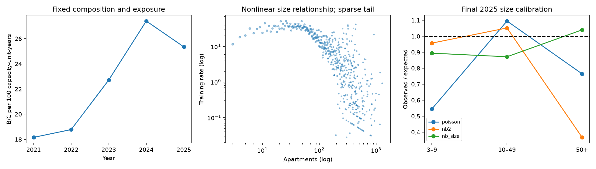

# Calibration and temporal validation (Phase 5)

## In short

- Compared five model variations by training on earlier years and predicting 2023 and 2024,
  then picked the one with the best calibration overall and within each building-size band.
- The winner (`nb_size`) lets the violation rate change with building size, with breakpoints
  at 10 and 50 apartments. It was refit on 2021–2024 and tested once on 2025.
- In 2025, actual violations were 93% of predicted, and 98.4% of buildings fell inside the
  model's 95% range.
- It still misses building history: buildings with many past violations got 2.6 times more
  than predicted, and buildings with none got far fewer.

Run `OPENBLAS_NUM_THREADS=1 VECLIB_MAXIMUM_THREADS=1 uv run python -m housing.model_validation`.
Existing Phase 3 tables and Phase 4 fitting/scoring are reused. No source data or analytical
tables are changed; no rankings, owner analysis or anomaly thresholds are produced.

## Diagnosis and fixed validation strategy

The population is fixed at 145,832 buildings. Building IDs, apartment counts and annual
exposure are explicitly checked for equality. Thus the recorded rate changes cannot be
explained by measured composition or denominator changes within this cohort. This does not
establish unchanged actual occupancy or physical capacity: attributes are current snapshots.

| year | buildings | apartments | violations | rate_per_100 | change |
| --- | --- | --- | --- | --- | --- |
| 2,021 | 145,832 | 2,255,098 | 409,527.00 | 18.16 | nan |
| 2,022 | 145,832 | 2,255,098 | 423,518.00 | 18.78 | 0.03 |
| 2,023 | 145,832 | 2,255,098 | 512,175.00 | 22.71 | 0.21 |
| 2,024 | 145,832 | 2,255,098 | 617,873.00 | 27.40 | 0.21 |
| 2,025 | 145,832 | 2,255,098 | 571,613.00 | 25.35 | -0.07 |

2025 B/C rate changes by **-7.49%** relative to 2024, reversing the
preceding growth. That is a practically relevant descriptive shift in recorded activity,
not proof of a change in underlying conditions, enforcement policy, or reporting completeness.
`temporal_composition.csv` separates size and borough changes with fixed capacity exposure.
NB2's Phase 4 training O/E of 0.664 establishes that temporal drift alone cannot explain
its overprediction. NB likelihood downweights large expected counts in the mean score;
unlike Poisson with an intercept, it need not match the total observed count. A single
size slope and very high dispersion can fit the many zeros while misfitting large buildings.

Two rolling-origin validations: train 2021–2022 / validate 2023, then train 2021–2023 /
validate 2024. Both use the same current cohort. Select by mean fold calibration loss:
absolute log aggregate O/E plus the unweighted mean absolute log O/E in size bands
3–9, 10–49 and 50+. Break ties by negative log likelihood. Equal size-band weighting
prevents the many small buildings from hiding large-building errors. Zero prediction,
MAE, deviance and interval coverage are evaluated but do not retroactively change this rule.
`plan.json` precedes fitting; `decision.json` persists the chosen model and validation hash
before 2025 is queried. Selection uses only validation years 2023 and 2024.

**2025 was already inspected in Phase 4**, so it is a reused retrospective evaluation period,
not a pristine holdout. This phase does not use its outcomes for specification selection or
hyperparameter tuning. Earlier exposure to those findings and current-stock eligibility
limit claims of independent forecasting validation.

## Three adjustments, plus unchanged reference models

1. `nb_size`: NB2 with two continuous hinge terms in log apartment count, at 10 and 50
   apartments. These knots follow existing cohort size bands, not optimized outcomes.
2. `nb_size_flat`: the same size terms; the fitted calendar trend stops at the final
   training year when predicting the next year. No evaluation-year total is used.
3. `poisson_size_nb_variance`: the same size terms with Poisson mean estimation; then fit
   NB2 dispersion by training likelihood holding the mean fixed. This is a two-stage
   predictive baseline, not joint NB maximum likelihood or a new significance model.

The apartment offset is retained as capacity exposure. The log-size coefficient and hinges
relax proportional scaling; together offset and predictor can express nonlinear elasticity.
The Poisson/NB2 references retain the original specification. Borough, age and calendar
controls stay fixed. Historical violations are diagnostic strata only: including them as
peer-model predictors could normalize persistent adverse activity. No building-ID effects.
`training_size_curve.csv` shows pre-2025 count/rate relationships and sample sizes; sparse
large-building observations warrant caution. No assumption of actual occupied-unit exposure.

## Pre-2025 comparisons and frozen decision

| model | calibration_loss | aggregate_oe | mean_negative_log_likelihood | predicted_zero_fraction | interval95_coverage |
| --- | --- | --- | --- | --- | --- |
| nb2 | 0.64 | 0.77 | 1.18 | 0.81 | 0.98 |
| nb_size | 0.22 | 1.12 | 1.17 | 0.81 | 0.98 |
| nb_size_flat | 0.40 | 1.22 | 1.17 | 0.81 | 0.98 |
| poisson | 0.39 | 1.13 | 6.33 | 0.29 | 0.80 |
| poisson_size_nb_variance | 0.26 | 1.13 | 1.18 | 0.81 | 0.98 |

Selected **nb_size**, then refitted through 2024. Full fold metrics and group results are
in `validation_models.csv` and `validation_groups.csv`; averaged O/E values above do not
replace those individual fold results. 2025 results do not trigger reselection.

## Final retrospective evaluation

| model | aggregate_oe | mean_negative_log_likelihood | mae | observed_zero_fraction | predicted_zero_fraction | interval95_coverage |
| --- | --- | --- | --- | --- | --- | --- |
| poisson | 0.82 | 6.47 | 5.69 | 0.81 | 0.22 | 0.76 |
| nb2 | 0.62 | 1.17 | 6.90 | 0.81 | 0.80 | 0.98 |
| nb_size | 0.93 | 1.17 | 5.14 | 0.81 | 0.79 | 0.98 |

Selected-model O/E is **0.932**; observed zero fraction
**80.58%**, predicted **79.47%**;
conditional 95% count-interval coverage is **98.37%**.
Lower negative log likelihood/MAE are better, but mean calibration and distributional
calibration are distinct. A mean improvement alone does not validate tails or zeros.

`final_groups.csv` records O/E by borough, size band, size quantile and prior mean annual
violations (zero, 0–5, 5–20, 20+). Historical strata use only the preceding training years.
| group_type | group | n | oe |
| --- | --- | --- | --- |
| size_band | 10–49 | 28,026 | 0.87 |
| size_band | 3–9 | 107,500 | 0.89 |
| size_band | 50+ | 10,306 | 1.04 |
| borough_id | 1 | 25,475 | 0.87 |
| borough_id | 2 | 19,602 | 0.94 |
| borough_id | 3 | 67,605 | 0.96 |
| borough_id | 4 | 31,826 | 0.89 |
| borough_id | 5 | 1,324 | 1.27 |
| history | 0–5 | 29,406 | 0.44 |
| history | 20+ | 6,303 | 2.60 |
| history | 5–20 | 11,901 | 1.01 |
| history | zero | 98,222 | 0.15 |

The size adjustment substantially reduces the original large-building overprediction.
Historical-activity calibration remains poor: a peer baseline does not predict each
building's persistent history. These strata are essential context for any future screening,
not evidence that high-history buildings are independently significant outliers.
Estimated count elasticities across size segments are **[2.074, 0.857, -0.092]**.
The largest-size segment is approximately flat rather than proportional to apartments;
this is an association in the current cohort and should not be extrapolated beyond support.
The log-scale size diagnostic omits zero-rate dots; the CSV retains every group.
Size quantile edges are learned from unique training buildings; tied apartment counts
collapse quantile bins rather than arbitrarily splitting identical sizes into ten groups.
Local outputs `data/model_validation/*_2025.csv.gz` contain residual diagnostics, not priority ranks.

## Uncertainty and readiness

A paired **BBL cluster bootstrap**, 300 draws with fixed seed 501, resamples complete lots.
It preserves dependence within each lot and pairs 2024/2025 outcomes. Selected model
aggregate O/E descriptive bootstrap interval: **[0.9082694428514977, 0.9570988619478604]**.
Paired year-over-year rate-change interval: **[-0.09195339603452977, -0.05586684835496341]**.
See `uncertainty.json` for both references as well.

These intervals quantify empirical between-lot variability conditional on the fitted model
and the current inventory. They do not refit model coefficients, represent a probability
sample of NYC, account for neighborhood-wide dependence, or capture temporal regime
uncertainty. Treat them as stability diagnostics, not confidence that the model is correct.
Count intervals additionally condition on estimated dispersion and coefficients; discrete
coverage can exceed 95%, and serial building effects are not modeled.

**No formal statistical anomaly claims are justified.** The selected fit is at most an
exploratory expected-count comparator. Check the final size/geography/history calibration
and residual behavior before using it for screening. Persistent differences between zero-
and high-history buildings reflect unmeasured heterogeneity and inspection opportunity;
conditioning those away changes the investigative question. Phase 4's large-building
mean failure and the 2025 growth reversal are distinct limitations. A stationary or linear
trend cannot guarantee comparisons across a new activity regime.

Further work should validate practical excess-count measures and consequential records,
consider training-only temporal and subgroup specification checks, and establish appropriate
predictive uncertainty before thresholds. Do not select a new specification using these
2025 results while continuing to describe 2025 as independent validation. No wrongdoing
can be inferred from a statistical deviation. Stop after Phase 5.

Tests cover pre-2025 selection guards, predictors, temporal caps, exposure identities,
bootstrap reproducibility, and output integrity. Provenance and selected coefficients are
retained alongside the reports; run `python -m pytest -q` and `python -m ruff check housing tests`.
